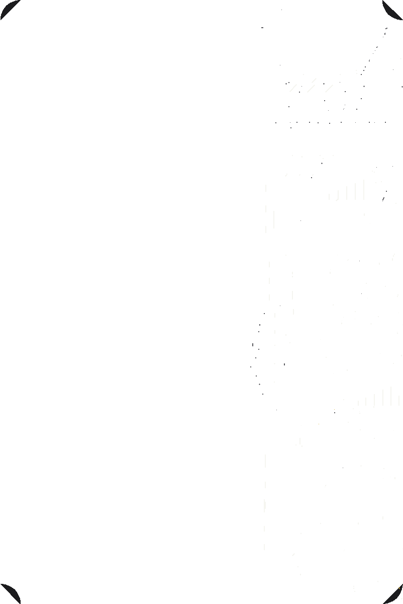

# PCB Art 作品集 · PCB Art Portfolio

使用 [立创EDA专业版](https://lceda.cn/)（LCEDA Pro）设计并使用 AI 辅助生成的 PCB 艺术板（PCB Art）。每块板为 **64 × 96 mm 圆角卡片**，以铜箔（沉金）+ 丝印双层构成完整画面，可直接制造为钥匙扣 / 挂件。

Designed in LCEDA Pro with AI assistance. Each board is a 64 × 96 mm rounded-corner card — the artwork itself is built from copper (ENIG) traces and silkscreen, ready to fabricate as a keychain / charm.

## 作品 / Works

### 初音未来 · v9 钥匙扣贴边版 (Hatsune Miku v9 Keychain)
- 黑色阻焊 + 沉金走线（频谱柱、边框、电路纹理）+ 白色丝印人物线稿（双马尾、眨眼、CV01、39）
- 黑色 soldermask + ENIG gold traces (equalizer bars, borders) + white silkscreen line-art of Hatsune Miku
- 渲染图：[`初音v9钥匙扣/初音v9_PCB1.png`](初音v9钥匙扣/初音v9_PCB1.png)
- 源文件：[`初音v9钥匙扣/初音v9_钥匙扣贴边版.epro2`](初音v9钥匙扣/初音v9_钥匙扣贴边版.epro2)（立创EDA专业版工程，可直接打开）

### 八重神子 · R5 圆角校准双版 (Yae Miko R5, two variants)
- 同一版式的两个配色变体：「黑金弧槽」与「彩印弧槽」
- Two colorway variants of the same layout
- 渲染图：[`八重神子R5/`](八重神子R5/)
- 源文件：[`八重神子R5/八重神子R5_圆角校准双版.epro2`](八重神子R5/八重神子R5_圆角校准双版.epro2)

## 预览 / Preview

| 初音 v9 | 八重神子（黑金） | 八重神子（彩印） |
| --- | --- | --- |
|  |  |  |

## 说明 / Notes

- 板子规格：64 × 96 mm，圆角矩形，四角 R5 圆角
- 图形全部由真实铜箔层 / 丝印层 / 阻焊开窗层构成，不是贴图
- `.epro2` 为立创EDA专业版工程文件，[下载立创EDA专业版](https://lceda.cn/page/download) 后可直接打开编辑
- 渲染图由自研 Python 渲染器从工程文件图层（copper / silk / mask opening / outline）直接生成
